 

**[Quem somos](#-quem-somos)** · **[Soluções](#-nossas-soluções)** · **[Diferenciais](#-por-que-a-nextscale)** · **[Projetos](#-projetos)** · **[Contato](#-vamos-conversar)**

 

## 🟢 Quem somos

A **NextScale** nasceu com o propósito de transformar ideias em soluções digitais. Acreditamos que tecnologia e criatividade são ferramentas essenciais para construir projetos modernos, fortalecer marcas e impulsionar negócios.

Atendemos **pessoas, profissionais e empresas** que querem crescer e fortalecer sua presença no ambiente digital, com soluções modernas, personalizadas e eficientes.

 

## 🚀 Nossas soluções

Unimos tecnologia, criatividade e estratégia para desenvolver soluções que fazem a diferença no ambiente digital. **Clique em cada serviço para ver mais.**

<b>💻 &nbsp;Criação de sistemas</b>

 

Desenvolvemos sistemas personalizados para **automatizar processos**, **organizar informações** e **facilitar a gestão** do seu negócio.

> Ideal para quem quer sair de planilhas e tarefas manuais e ter uma ferramenta feita sob medida.

<b>🌐 &nbsp;Criação de sites</b>

 

Criamos sites **modernos, responsivos e profissionais** para fortalecer sua presença digital e apresentar sua marca ao mundo.

> Ideal para quem precisa de uma vitrine online clara, rápida e bem acabada.

<b>📈 &nbsp;Tráfego pago</b>

 

Desenvolvemos estratégias de **anúncios digitais** para aumentar a visibilidade da sua marca e alcançar potenciais clientes.

> Ideal para quem já tem presença online e quer ser encontrado por mais pessoas.

 

## ⚡ Por que a NextScale?

| | Diferencial | O que significa |
|:-:|:--|:--|
| 🧩 | **Soluções personalizadas** | Cada projeto é pensado para a realidade e os objetivos do seu negócio. |
| ⚙️ | **Tecnologia moderna** | Ferramentas atuais para entregar projetos rápidos, seguros e preparados para evoluir. |
| 🎨 | **Design profissional** | Interfaces claras e bem acabadas, que valorizam sua marca. |
| 🛡️ | **Compromisso com a qualidade** | Atenção aos detalhes em cada etapa, do planejamento à entrega. |

 

## 📂 Projetos

Os projetos da NextScale serão listados aqui conforme forem publicados.

<b>Como acompanhar</b>

 

- Veja os repositórios públicos da organização na aba **Repositories**.
- Use a estrela ⭐ nos que mais gostar para encontrá-los depois.
- Para falar de um projeto específico, chame a gente pelo contato abaixo.

 

## 💬 Vamos conversar?

Tem uma ideia ou precisa de uma solução digital para o seu negócio? Vamos conversar e transformar o seu projeto em realidade.

<b>Como pedir um orçamento</b>

 

Envie uma mensagem com estas informações:

1. **Seu nome** e um contato (e-mail ou telefone).
2. **Tipo de serviço**: sistema, site, tráfego pago, ou "ainda não sei".
3. **Descrição do projeto**: o que você quer resolver ou criar.

Também dá para preencher o formulário em **[seudominio.com.br](https://seudominio.com.br/#contato)**.

 

 

© 2026 NextScale. Todos os direitos reservados.

